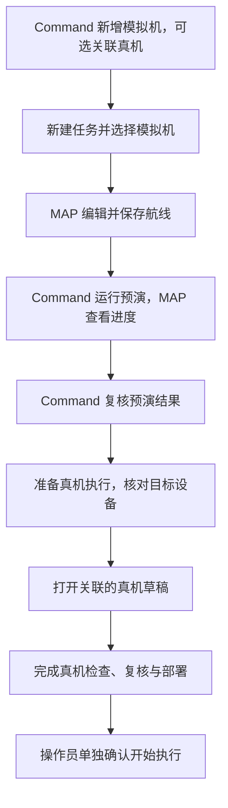

# 安保方案模拟预演与真机执行设计

2026-11-26 · 设计评审稿

操作员可以在创建模拟机时关联一架已登记真机。安保任务仍选模拟机完成预演。复核通过后，Command 在「准备真机执行」中带出提前选定的真机，经操作员确认后生成沿用已复核航线的真机草稿。真机草稿沿用现有的检查、复核、部署和独立开始确认。

第一版沿用现有的**单机预演转单架真机**。Command 负责设备关联、任务配置、预演复核和真机执行确认，MAP 负责编辑航线、展示预演进度和回放。两端连接同一个 Backend，方案、分配和执行状态以 Backend 为准。预演使用软件预演适配器，真机执行使用 Real 适配器。

## 现有流程

操作员目前在 Command 的机队页新增模拟机，在安保方案里将模拟机分配给任务，并在 MAP 编辑保存航线。完成单机预演和复核后，操作员选择已登记真机，Backend 创建一份关联该次预演的真机草稿。草稿进入真机检查，后续由操作员复核、部署并单独确认开始。 [现有预演流程](../Launcher/README.md#mission-rehearsals) · [Backend 分配逻辑](../Backend/storage/rehearsal.inl)

已有协议验收采用回环硬件替身，覆盖单机预演复核、保存真机待执行分配和同槽位更换设备后的拒绝。原生 UI 证据覆盖在 Command 新增模拟机，以及在 MAP 查看预演进度和结果。真机飞行仍待现场验收。 [现有验收记录](../Evidence/SimulationRehearsal/2026-11-20/validation.md)

## 操作员流程

### 创建模拟机时关联真机

1. 在 **Command → 机队 → 新增模拟机** 的现有表单中加入可选字段「关联真机」，默认显示「暂不关联」。
2. 启用该字段后，从已登记真机中选择一架。选项显示真机名称、设备编号和当前连接状态。已登记的离线设备也可作为候选，连接状态留到真机检查时再次确认。
3. 确认后一起保存模拟机和关联。机队列表在模拟机编号旁显示「已关联 UAV-02」，并允许在模拟机详情中更换或解除关联。候选关系可在任务中使用，真机占用由现有执行检查决定。

第一版在创建数量为一架时展示关联字段。现有批量新增继续使用原表单，创建后可在各模拟机详情中单独设置关联。保存失败时保留表单输入并显示原因，操作员可重试或选择暂不关联。

### 新建安保任务并运行预演

1. 在 Command 新建方案和任务，将模拟机分配给任务。设备区域同时显示「预演设备 SIM-04」和「关联真机 UAV-02」。任务保存时记录本次候选设备，随后可在任务详情中复查。
2. 操作员在 MAP 保存航线后，从 Command 点击「运行预演」。MAP 展示该次预演的航线和进度，完成后可查看结果和回放。
3. Command 将完成的预演显示为「待复核」。操作员核对航线和预演结果，点击「复核通过」。只有完整跑完当前版本航线的单机预演可进入「准备真机执行」。预演失败或航线已修改时，任务页显示具体原因和「重新预演」入口。

### 预演通过后准备真机执行

1. 在原任务的「模拟预演」区点击「准备真机执行」。确认区显示预演设备、复核结果、航线版本和目标真机。存在有效候选时自动填入该设备，操作员可以改选。没有候选时，沿用当前的真机选择界面。
2. 操作员确认目标真机后，Backend 复用现有的预演分配逻辑，保存一份独立真机草稿。Command 打开该草稿，在页首显示 **「真机方案 · 待检查」** 和实际分配的设备。原模拟任务可通过「查看真机方案」重新打开这份草稿，真机草稿也可返回源预演。
3. 真机草稿沿用现有的检查、复核和部署。部署完成后显示「已部署 · 待开始」。操作员单独点击「开始真机执行」，确认窗口列出方案名称、真机编号、航线版本和已有的开始方式。真机适配器、设备身份、连接、定位和标定按现有 Backend 规则检查。收到执行状态后，Command 显示真实阶段，执行进度以真机遥测为准。 [真机执行条件](P54-Real-Adapter.md#default-and-activation-boundary)

提前关联、通过预演复核、保存真机草稿和部署，分别只推进各自的业务阶段。开始执行由独立的操作员确认和 Backend 检查触发。

## Command 的类型与执行状态

### 安保方案列表

将**类型**和**状态**放在方案名称旁，设备编号放在同一行。类型使用文字标签，筛选项为「全部」「模拟方案」「真机方案」。高亮用于辅助识别真机执行中和异常状态。

| 方案 | 类型 | 状态 | 设备 |
| --- | --- | --- | --- |
| 园区巡检 | **模拟预演** | 预演已复核 | SIM-04 · 已关联 UAV-02 |
| 园区巡检 | **真机方案** | 待检查 | UAV-02 |
| 周界巡检 | **真机方案** | **真机执行中** | UAV-03 |
| 新建巡检 | 待分配 | 草稿 | 待选设备 |

模拟任务保留「模拟预演」类型，关联设备在设备列显示为候选。真机草稿在生成后即显示「真机方案」，即使还在等待检查。旧模拟执行记录归入「模拟方案」，旧真机执行记录以其 Backend 执行模式和实际设备身份归类。方案和设备资料不足时，在「全部」中显示「类型未确认」，等待权威状态回读。设备编号格式和方案名称只用于展示。

### 方案详情与执行页

- 页首固定显示**方案名、类型、当前状态和设备编号**。模拟任务下方保留预演结果与回放入口，真机方案显示实际分配的设备和真机检查结果。
- 同名的原模拟方案和真机草稿通过类型及设备区分，详情提供双向跳转。多任务方案的任务行分别标记自身设备和状态。
- 操作员提交开始请求后先显示「正在确认」或 Backend 返回的「待开始」「启动中」。只有 Backend 确认进入真实执行阶段才显示 **「真机执行中」**。暂停、完成、失败及终止显示各自状态，检查失败或设备异常时显示 Backend 给出的原因。
- Command 刷新或重连后用 Backend 快照恢复类型、设备和状态。MAP 随当前任务展示对应航线。编辑、已保存航线、移动预览和执行快照沿用 Route V2 单一显示所有者规则，每个 Mission 在同一时刻只有一个显示来源。航线编辑期间保留手动平移、缩放和 3D 旋转，自动跟随和聚焦继续锁定，左键航点手势独立处理。 [路线配置与占用](PLAN-Configuration-Workflow.md) · [地图交互约定](UIInteractionFollowup.md)

## 数据与变更规则

| 记录 | 保存内容 | 使用时机 |
| --- | --- | --- |
| 模拟机默认关联 | 模拟机 ID、真机登记 ID、用于展示的编号和关联版本 | 新任务选择该模拟机时预填候选。更换或解除关联后，对后续任务生效。 |
| 任务候选真机 | 本次任务明确采用的真机登记 ID 和关联版本，可为空 | 预演前展示，复核后用于「准备真机执行」。后来更改默认关联时，由操作员在任务中明确更新候选。 |
| 预演与复核 | 现有预演记录、航线快照、影响预演的任务参数和复核结果 | 准备真机草稿时核对该次复核是否对应当前任务版本。 |
| 真机草稿与部署 | 源方案、源任务、源预演记录、实际选择的真机登记 ID、航线版本 | 关联草稿、部署和执行记录均可追溯，执行检查使用草稿实际选定的设备。 |

Backend 用稳定登记身份核对真机。编号是操作员看到的标签，同一槽位重新登记另一架设备时，旧关联显示「设备已变更」，由操作员重新选择。每个模拟机可保存一架默认真机。多个任务引用同一候选时，部署和开始仍使用现有的设备占用检查。

| 情况 | 系统行为和界面动作 |
| --- | --- |
| 修改航线、编队参数或预演模拟机 | 源任务的旧结果留作历史，准备入口显示「任务已变更，请重新预演」。重新预演并复核后才可用新内容准备真机草稿。 |
| 准备前改选真机 | 航线和预演输入相同时沿用已有复核。界面显示改选结果，由 Backend 对新目标重新做真机检查。 |
| 已有真机草稿后修改模拟机默认关联 | 原草稿及其部署记录继续使用已保存的实际分配。要使用另一架真机，由操作员回到已复核预演，明确发起新的分配并重新检查、复核和部署。源任务优先打开当前选定的真机草稿，已有草稿及执行历史仍可按设备查阅。 |
| 真机已登记但离线、缺少有效定位或被占用 | 保留候选和待检查草稿，显示相应阻塞原因。设备条件恢复后可重新检查。开始前再次校验最新状态。 |
| 双击、超时重试或 Command 重连 | 同一次确认沿用同一请求标识。Backend 保存草稿和回执，重试返回原草稿 ID。Command 恢复关联和待处理状态后继续。 |
| 正在编辑航线或另有配置占用 | 使用现有配置占用和版本校验提示。操作员结束冲突会话后再继续，Backend 核对当前会话所有者。 |

## 现有流程兼容

- **未关联的模拟机和历史模拟任务**按原流程运行预演。原有手动「分配真机」仍可在单机预演复核后使用，默认关联由操作员按需补充。
- **已直接选择真机的任务**仍从原有真机方案入口检查、复核、部署和开始。单机预演的复核记录用于从模拟任务转出的草稿。
- **现有批量模拟机和多机预演**继续用于预演和回放。从预演生成真机草稿时沿用现有单机限制，界面在多机结果处显示「请先预演单机版本」。
- **已部署方案、预约和执行历史**继续从原快照与执行记录读取。关联字段可缺省，旧数据通过现有设备和执行信息展示类型。编辑、部署与执行使用现有配置占用和版本检查。
- **复用已有业务入口。** 在模拟机新增和详情增加可选关联，在现有「分配真机」确认区增加预填，在 Command 的方案列表和详情投影类型及状态。Backend 继续用现有预演复核、真机分配、部署和执行流程处理各阶段。

## 验收用例

| 检查 | 操作和预期结果 | 证据 |
| --- | --- | --- |
| 创建与回读 | 新建单架模拟机并关联已登记真机，列表显示关联。重启 Backend 并重连后仍可回读。另测暂不关联、解除关联和原有批量创建。 | 原生 UI、Backend 持久化 |
| 任务预填 | 任务选择已关联的模拟机后同时显示两个设备编号，任务的预演记录使用模拟设备。调整默认关联后，已有任务候选保持，下一次新建任务使用更新后的候选。 | 原生 UI、Backend 快照 |
| 预演与复核 | 保存航线、运行单机预演、在 MAP 查看进度和回放、在 Command 复核。通过复核后才显示可用的准备入口。失败或尚未结束的记录无法用于准备。 | 原生 UI、协议及组件自动化 |
| 转为真机草稿 | 复核后准备，自动带出有效候选，确认后只生成一份真机草稿并跳转。回读源预演和航线版本一致，源模拟任务与真机草稿均可打开。用缓慢响应、重试和重连检查重复提交。 | 原生 UI、协议及 Backend 快照 |
| 同名方案与执行状态 | 在 Command 列表同时查看同名模拟方案和真机草稿，筛选和文字标签正确。状态用例覆盖待检查、已部署待开始、启动中、真机执行中、暂停及结束。回读实际执行状态后才显示真机执行中。 | 原生 UI、组件自动化 |
| 失效与换机 | 覆盖预演后改航线、准备前改选真机、离线、占用和同槽位更换登记设备。核对旧复核或旧登记身份被拒时有可操作提示，换机后重新检查目标设备。 | Backend 单元及协议验收 |
| 开始边界 | 使用隔离环境与 Real 适配器替身，确认关联、预演、复核、生成草稿及部署阶段的硬件指令记录均为零。只有通过独立开始确认和 Backend 检查后，替身执行记录才发生预期变化。 | Backend 协议与替身验收 |
| 兼容回归 | 用历史数据分别运行未关联模拟机、预演后手选真机、直接分配真机及多机预演。检查类型、回放、配置占用释放、MAP 编辑手势和每个 Mission 的航线显示所有权。 | 原生 UI、协议及组件自动化 |

原生 UI 验收分别保留机队关联表单、同名方案列表、预演复核、真机草稿和开始确认的界面记录。协议及组件自动化保存独立结果，覆盖 Backend 回执、版本、状态转换与重试。真实飞行由独立现场验收记录确认，记录所用设备和版本、操作员确认、真机遥测及执行结果。 [证据范围](../Evidence/SimulationRehearsal/2026-11-20/validation.md)
