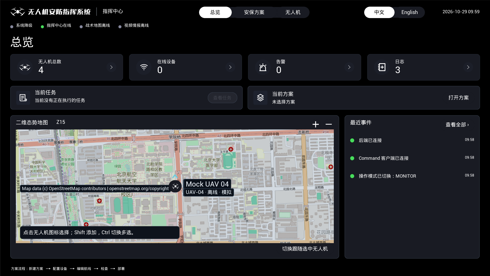
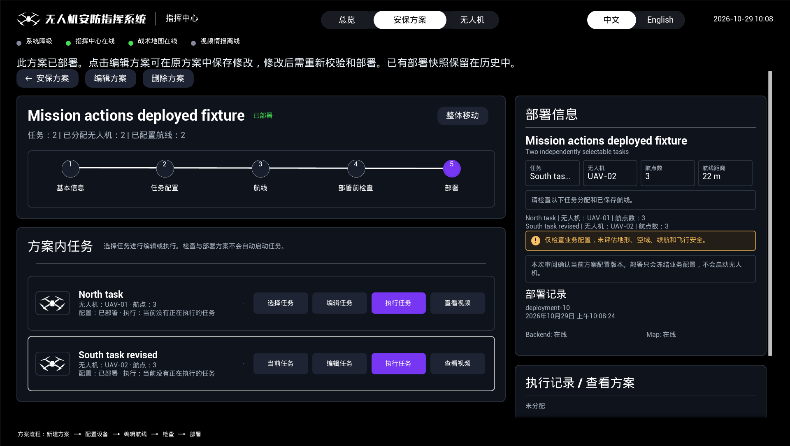
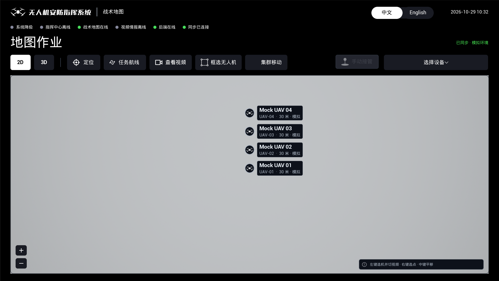
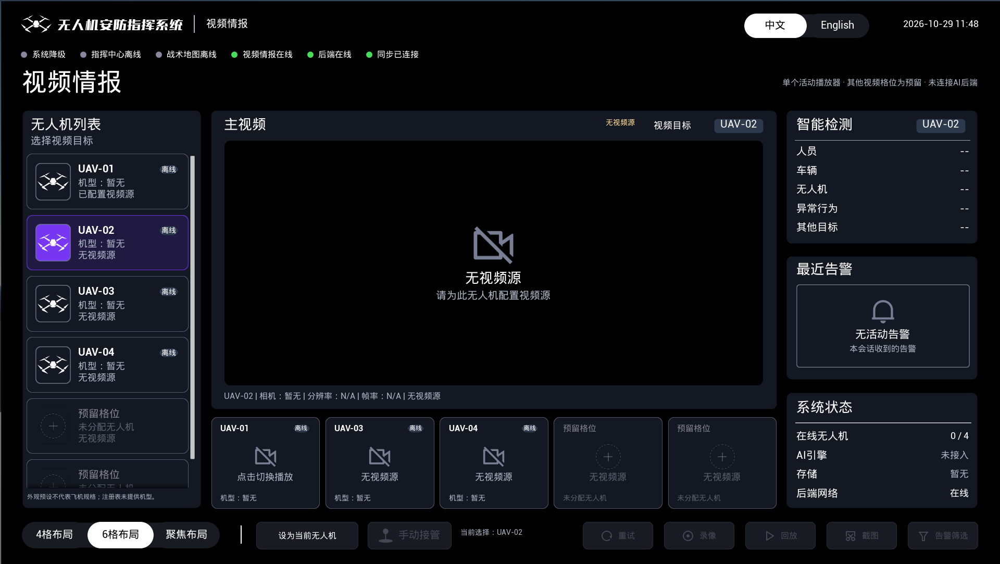

# 四个页面的验收预览

覆盖总览、方案详情、战术地图和视频情报。前三页沿用已经核对来源的原始验收截图；视频页为本轮补齐界面后重新生成的当前构建截图。全部属于 UE RHI 渲染自动化 / 隔离 Mock；不代表真实摄像头播放或原生飞行接管。来源和模块身份见 [核对记录](preview-audit.json)。

## 指挥中心 · 总览

四项统计、当前任务 / 方案、地图和最近事件。

[打开原图](screenshots/command-overview.png)

## 安保方案 · 详情

双栏布局、五步流程、任务操作和部署信息。

[打开原图](screenshots/plan-detail-zh.png)

## 战术地图 · 地图作业

框选、集群移动、手动接管和当前设备选择。

[打开原图](screenshots/map-main.png)

## 视频情报 · 六格布局

新补齐底部手动接管图标与引导，并调整底栏和细分隔线。Video 角色仅监看，接管按钮禁用；实际操作在地图或指挥中心确认。

[打开原图](screenshots/video-six.png)

## 其他状态

- [总览：多任务运行](screenshots/overview-active-tasks.png)
- [方案详情：英文](screenshots/plan-detail-en.png)
- [地图：设备下拉](screenshots/map-dropdown.png)
- [地图：3D](screenshots/map-3d.png)
- [地图：航线编辑](screenshots/map-route.png)
- [视频：四格](screenshots/video-four.png)
- [视频：聚焦](screenshots/video-focus.png)
- [视频：英文](screenshots/video-focus-en.png)

[完整验收](acceptance.json) · [视频专项](video/validation.json)
