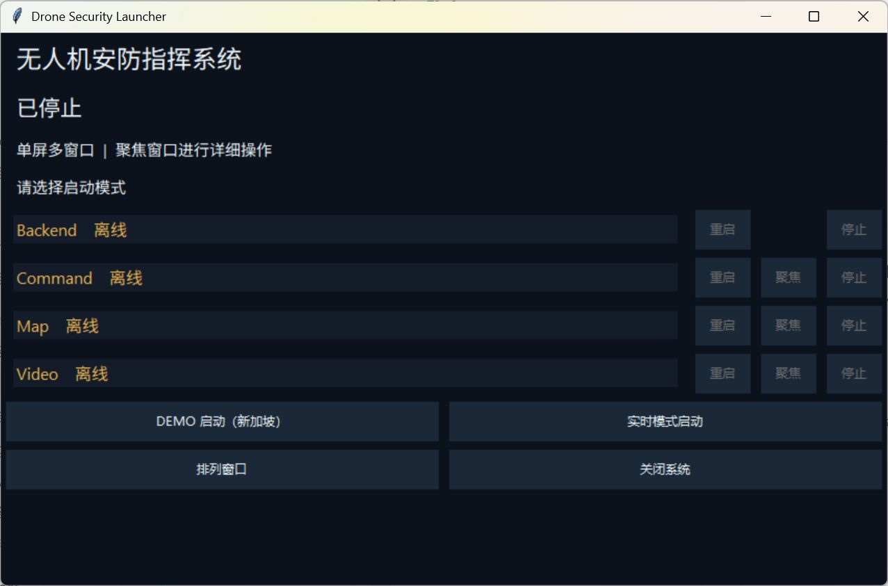
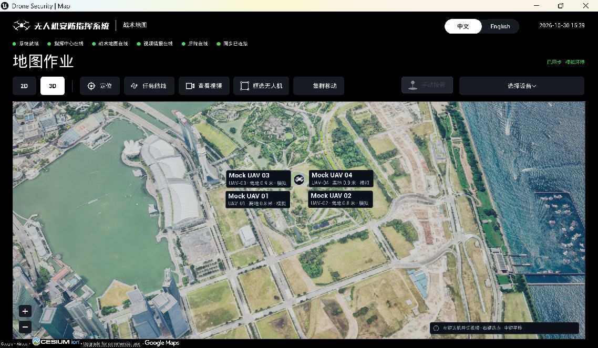

# 启动器双模式与 Map 验收

本轮新增 DEMO（新加坡）和实时启动，并实际点击两个按钮核对生产 Map 场景。实时优先新鲜的无人机 GPS，无真实连接时采用电脑 Windows 定位。

## 启动器

## DEMO：新加坡

稳定加载后，三维新加坡底图和四架模拟机可见；原点与启动参数一致。初次出现的深色形状在重启后未复现，没有通过隐藏模型、缩放模型或关闭渲染功能规避。

[首次异常画面](screenshots/demo-initial.png) 保留。

## 实时：电脑位置分支

实际按钮启动达到 READY，Map 原点与该次 Windows 定位一致。实时启动现在默认采用原有二维卫星底图，保留手动三维入口，避免未显示地表的三维启动画面。空后端机队的旧 Mock 标签已清除，原生日志记录清理了 8 个旧场景对象。

涉及实际电脑位置的截图、原始 Map 日志与坐标只留本地；此页不发布精确定位资料。原生验收使用独立后端端口、业务目录和每角色注册表，地图、相机、底图与定位逻辑未替换。

63 项 Launcher 检查、7 项隔离启动检查、16 项 Backend 传输检查通过。UE 各次运行的模块身份单独保留，最终模块的 2 项针对性检查通过；没有把早期检查描述为最终 DLL 全量重跑。

真机 GPS、真实飞行及非零 geoid 高程没有完成原生验收；已记录的真机高程专项风险见 [验收汇总](acceptance.json)。[来源清单](provenance.json) 保留复制前哈希，公开日志另行脱敏。
